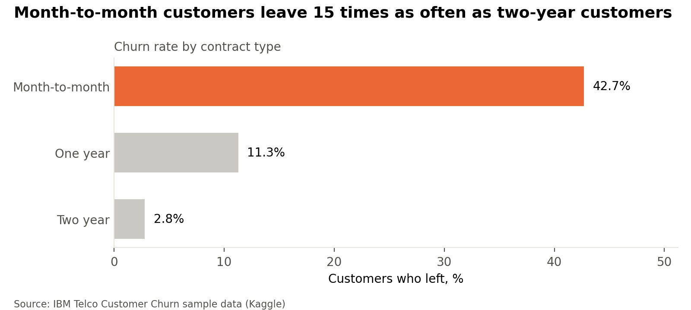
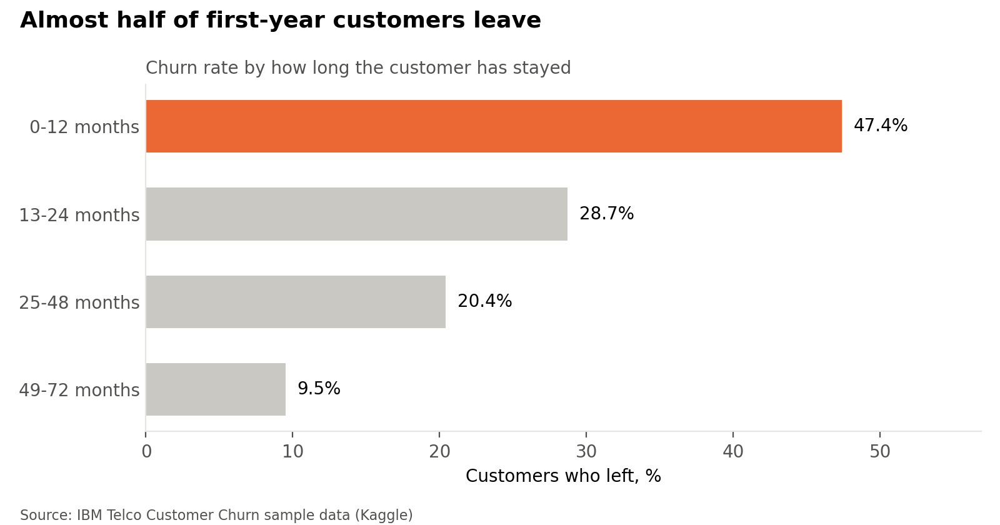
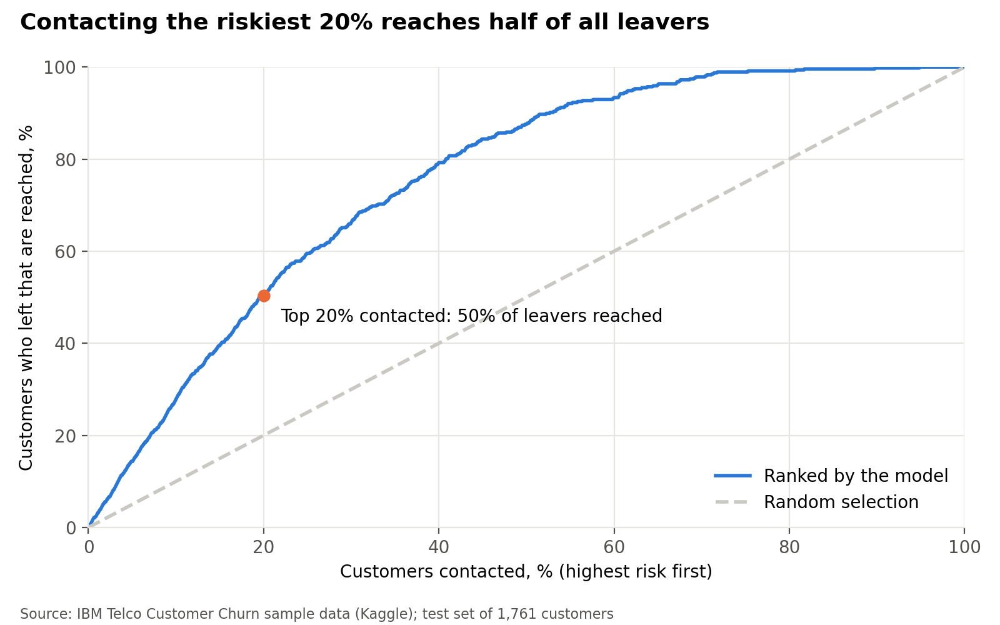

# Telecom churn: a model that finds half of all leavers by contacting one customer in five

**26.5% of customers left, taking 30.5% of monthly revenue with them. Ranking customers with a logistic regression model (ROC AUC 0.85) means contacting the riskiest 20% reaches 50% of leavers and 55% of the revenue at risk, against 20% with random selection.**

**Tools:** Python (pandas, scikit-learn, SciPy, matplotlib), Jupyter

**Data:** [IBM Telco Customer Churn](https://www.kaggle.com/datasets/blastchar/telco-customer-churn) sample data, 7,043 customers of a fictional telecom provider

**Notebook:** [`churn_analysis.ipynb`](churn_analysis.ipynb)

---

## Business question

Which customers are most likely to leave, and if the company can only contact some of them with a retention offer, which ones should it contact?

## Findings

### 1. One customer in four leaves, taking almost a third of monthly revenue

Of 7,043 customers, 1,869 left (26.5%). Their monthly charges total $139,131, or 30.5% of the company's $456,117 monthly revenue.

### 2. Month-to-month and first-year customers leave most

Month-to-month customers leave at 42.7%, about 15 times the rate of two-year customers (2.8%). Almost half of customers in their first year leave (47.4%), against 9.5% of those who have stayed over four years. Fibre optic (41.9%) and electronic check (45.3%) customers also leave more often. Chi-square tests show all four differences are statistically significant; gender makes no difference (p = 0.49). These results show which groups leave more, not why.

### 3. A simple model ranks customers well

Logistic regression scores a ROC AUC of 0.847 on the unseen test set and a random forest 0.845, where 0.5 would be random guessing. I chose logistic regression: it performs as well and is easier to explain. Accuracy alone would mislead here, since predicting that nobody leaves is already 73% accurate.

### 4. Contacting the riskiest 20% reaches half of all leavers

Contacting the 20% of test customers the model rates riskiest reaches 235 of the 467 who left (50%), against 20% with random selection. Two in three contacted customers (67%) were actual leavers, and the group holds 55% of the monthly revenue lost to churn.

## Recommendation

- **Target with the model:** each month, send retention offers to the 20% of customers the model rates riskiest.
- **Move month-to-month customers onto contracts,** for example with a discount for a one- or two-year plan; contract customers leave far less often.
- **Support first-year customers,** when almost half of leavers go.
- **Test before rolling out:** give the offer to half of the high-risk group and compare how many stay against the other half.

## Method

- **Cleaning:** 11 blank `TotalCharges` values belong to customers with tenure 0 (not yet billed) and were set to 0.
- **Statistics:** chi-square tests of independence between churn and contract, tenure, internet service, payment method and gender.
- **Model:** one-hot encoded features; 75/25 stratified train/test split; logistic regression (scaled numeric features) compared with a random forest; evaluated with ROC AUC, precision and recall on the unseen test set.
- **Targeting:** test customers ranked by predicted risk; share of actual leavers and lost revenue reached at the top 10%, 20% and 30%.

## Limitations

- The data is a sample from a fictional company covering one month of churn, so results may differ for a real provider.
- The model shows which customers are likely to leave, not why; whether an offer keeps them can only be shown by a test.
- Lost revenue is measured as leavers' monthly charges, not their full lifetime value.

## How to run it

See [GUIDE.md](GUIDE.md). Download the CSV from Kaggle into `data/`, then run the notebook top to bottom.

---

Olorunmaiye Peter Ayanfe 
